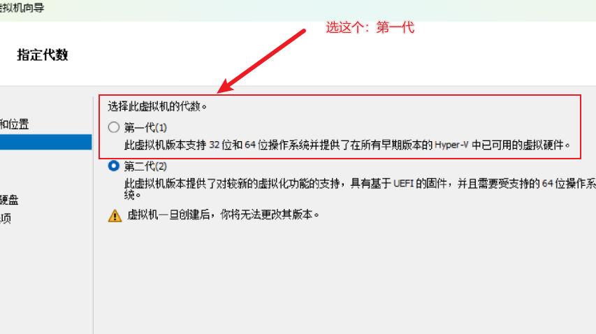
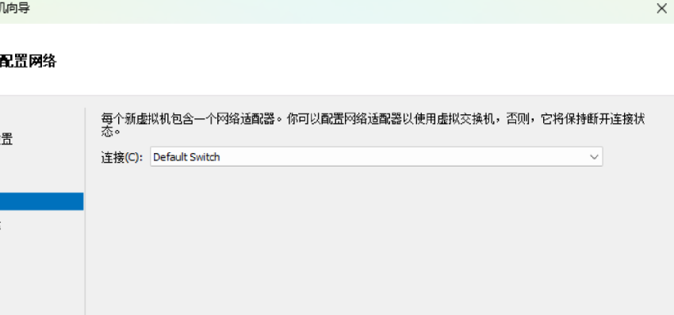

# Claude 稳定访问配置指南

本指南用于通过 VPS + Sing-box + Clash + Hyper-V 虚拟机构建稳定的 Claude 使用环境，降低风控风险。
虚拟机已经被封过claude账号的可以参考：https://github.com/Pluviobyte/claude-ban-clean 清理下环境

---

## 一、购买 VPS

**推荐要求：**

- 地区可选择美国西部、日本或新加坡；**不要选择香港**。Claude 官方支持地区包括美国、日本和新加坡，但目前未列出香港，可能无法正常访问。详见 [Claude 官方支持地区](https://support.claude.com/en/articles/8461763-where-can-i-access-claude)
- IP 尽量选择住宅 IP；若非住宅，纯净度必须高
- 便宜的VPS必须选小众VPS厂商，不要热门厂商，欧洲或北美二线VPS厂商

**推荐资源：**

- VPS 评测与购买参考
  1. https://digvps.com/review
  2. https://www.ittellyou.com/
  3. https://www.jzbk.net/
  4. https://www.vpsjyz.com/
  5. https://vpsledger.com/zh-hans/
- IP 纯净度测试
  1. https://ippure.com/
  2. https://ping0.cc/
  3. https://who.1ms.dog/zh-cn/
 
  （购买前可向客服索取测试 IP 进行检测）
- ping全国观察IP三大运营商连通度
  1. https://antping.com/ping

**系统要求：**  
推荐使用 Ubuntu 24.04 或 22.04。

---

## 二、VPS 配置（按顺序执行）

### 1. 一键安装 Sing-box

在 VPS SSH 终端执行：

```bash
bash <(curl -Ls https://raw.githubusercontent.com/eooce/sing-box/main/sing-box.sh) -i
```

脚本来源：https://github.com/eooce/Sing-box

### 2. 配置为 IPv4 模式

执行 `sb` 后，按提示操作：

```
sb
7  # 回车
6  # 回车
```

### 3. 开启 BBR 加速

在 Ubuntu VPS 终端执行以下命令检查当前状态：

```bash
sysctl net.ipv4.tcp_congestion_control
sysctl net.ipv4.tcp_available_congestion_control
sysctl net.core.default_qdisc
uname -r
```

**结果判断：**
- `net.ipv4.tcp_congestion_control = bbr` → 已启用 BBR
- `net.ipv4.tcp_congestion_control = cubic` → 当前为 CUBIC（需启用）
- `net.core.default_qdisc = fq` → BBR 推荐的队列调度配置

若未启用 BBR，执行：

```bash
sudo modprobe tcp_bbr
sudo sysctl -w net.ipv4.tcp_congestion_control=bbr
```

此操作立即生效，但已建立的连接可能不会切换。确认生效后，可进一步配置为开机永久生效。

### 4. 重启 Sing-box

```bash
sb
3  # 回车
```

### 5. 查看节点信息

```bash
sb -c
```

将输出的节点信息复制给 AI（如 GPT），生成 Clash 可用的 YAML 节点配置。

---

## 三、客户端配置（Clash）

1. 将生成的 YAML 导入 Clash。
2. **推荐客户端**：Clash Verge 或 Clash Nyanpasu。
3. **TUN 模式**：可直接开启，无需管理员模式启动。

**重要：**  
开启 TUN 模式与系统代理，并设置开机自启。

---

## 四、配置 Hyper-V 虚拟机

Claude 开发环境必须在虚拟机中使用，宿主机仅负责 TUN 转发。

### 1. 系统要求
- Windows 专业版（家庭版无法启用 Hyper-V）
- 激活参考：https://github.com/massgravel/Microsoft-Activation-Scripts

### 2. 开启 Hyper-V
按官方或搜索教程开启 Hyper-V 功能。

### 3. 安装纯净系统
- 推荐下载地址：https://msdn.itellyou.cn/
- 使用**一代激活**方法，避免二代激活（兼容性较差）,同时连接方式选择Default Switch





### 4. 环境架构说明
- **宿主机**：全程开启 TUN 模式进行流量转发
- **虚拟机**：实际运行 Claude 及相关开发环境

---

## 五、每次使用前检查清单

1. **地区与时区**  
   虚拟机 Windows 地区和时区必须与 VPS 所在地区一致。

2. **浏览器设置**  
   - 语言设置为 VPS 对应地区语言  
   - **备用语言中不得包含简体中文和繁体中文**
   - 启用安全 DNS，推荐 Cloudflare `1.1.1.1`

3. **网络状态检测**  
   打开 https://ip.net.coffee/claude/  
   确保检测结果全部为绿色后再使用 Claude。

---

## 六、重要注意事项

> Claude 采用积分制风控。注册时获得初始分数，之后根据行为加减分。分数低于阈值即封号，回分极难。

### 1. 注册阶段

- **干净 IP 是最重要因素**。不一定要住宅 IP，但必须足够干净。
- Gmail 已不再是最优选择，建议使用权重更高的付费邮箱服务。
- 注册时直接绑定手机 KYC 有机会加分，但并非一定成功。
- 使用手机 App 注册可加分。

### 2. 支付阶段

- 刚注册就立即订阅会扣分。
- 直接开通 Max 会大幅扣分。建议先等 1–2 天，再从 Pro 开始。
- 支付后立刻被踢下线，通常表示账号进入观察期，不一定直接封号。
- 海外实体银行卡可加分；Google Play 支付也可。虚拟卡会扣分。

### 3. 使用阶段

- 不要把额度用到极限。宁可多个号轮换，也不要把单个号用到封顶。
- Desktop 客户端扣分更少，尽量少用网页版。
- 手机端扣分也相对较少。
- 开启记忆功能可加分，记忆文件越多分数越高。

### 4. IP 与设备

- **稳定性是关键**。不要频繁换 IP，尽量一直使用同一个节点。
- 代理必须开启全局模式，并启用 TUN。
- 多设备登录会大幅扣分。理想状态是「一台电脑 + 一个客户端」。
- 频繁换 IP、频繁登录、高并发都会大幅扣分。

### 5. 账号年龄

- 老号有巨大的容错空间。2023 年及更早的账号明显更稳。
- 分数会随时间缓慢增长，但速度很慢。

### 6. 其他影响因素

- Windows 与 macOS 无明显差异；Linux 会扣分。
- 时区和语言基本不影响。即使是北京时间也不会单纯因此封号。
- Anthropic 官方称「不是中国人问题」，记忆功能本身不会触发封号。
- 大量使用 fable 会扣分。
- 升级到 Max 大概率会进入观察期（高权重老号除外）。

### 7. 观察期与封号

- 分数接近阈值时可能进入观察期。典型表现是被强制登出。
- 观察期若继续扣分，最终可能导致封号。
- 高分账号可扛过多次观察期。

### 8. 日常操作建议（总结）

1. 坚持「一机一号」，需要多账号时开多个虚拟机。
2. 不要频繁切换节点、账号或设备。
3. 新号建议养号 2–3 个月再正式使用。
4. 前 1–2 周，周限额用到 80%–85% 即停止，避免触达上限。
5. 注册尽量使用企业邮箱（可自建域名 + Cloudflare 实现无限邮箱）。
6. Claude 开发环境必须在虚拟机中使用，宿主机只负责 TUN 转发。

---

**文档版本说明：**  
本配置流程强调网络纯净度、环境一致性与账号稳定性，按步骤严格执行可显著降低 Claude 使用过程中的异常风险。
